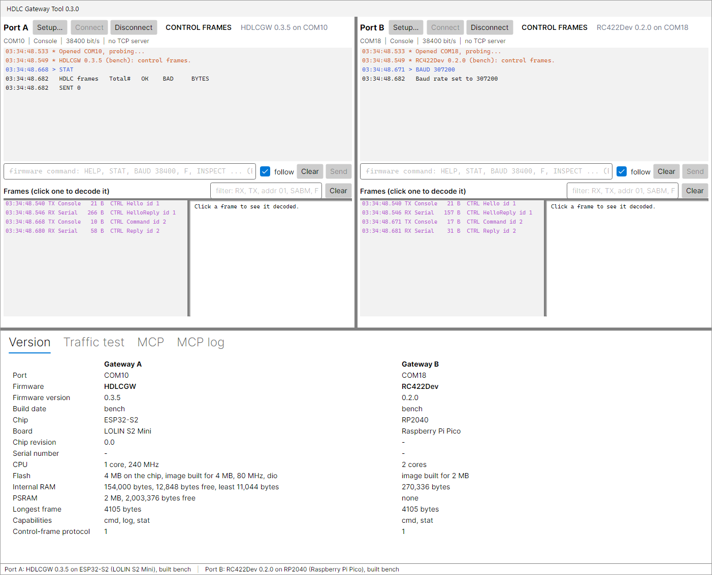

# HdlcGatewayTest

HdlcGatewayTest is the PC side of the RetroCore Labs HDLC gateways (the ESP32-S2 **HDLCGW** and the
Raspberry Pi Pico **RC422Dev**): a two-pane window and a command-line tool that drive the gateways,
list and decode every frame, bridge two of them, forward frames to the nd100x emulator over TCP,
run the traffic test that proves a gateway moves frames without loss, and let an AI client do all
of that over MCP.

[](https://github.com/RetroCoreLabs/HdlcGatewayTest/actions/workflows/build.yml)
[](https://github.com/RetroCoreLabs/HdlcGatewayTest/releases)
[](LICENSE)
[](https://github.com/RetroCoreLabs/HdlcGatewayTest/releases)

**Download** · [Docs site](https://retrocorelabs.github.io/HdlcGatewayTest/) · [What it does](#what-you-can-use-it-for) · [Quick start](#quick-start) · [MCP](#driving-the-tool-from-an-ai-mcp) · [Building](#building-from-source) · [About HDLC](#about-hdlc-and-these-gateways)

**Latest build for Windows, Linux and macOS:** https://github.com/RetroCoreLabs/HdlcGatewayTest/releases/latest

<picture>
  <source media="(prefers-color-scheme: dark)" srcset="https://raw.githubusercontent.com/RetroCoreLabs/HdlcGatewayTest/main/src/docs/screenshots/02-connected-version-dark.png">
  <source media="(prefers-color-scheme: light)" srcset="https://raw.githubusercontent.com/RetroCoreLabs/HdlcGatewayTest/main/src/docs/screenshots/02-connected-version-light.png">
  
</picture>

More pictures of the window (frame decode, setup, traffic test, MCP) are in the
[window's README](https://github.com/RetroCoreLabs/HdlcGatewayTest/blob/main/src/HdlcGatewayTest.App/README.md#screenshots).

## Why it exists

A gateway between a PC and a synchronous HDLC line has a lot of stages a single test frame
cannot see through: USB framing, bit stuffing, a transmit clock, a receiver on somebody else's
clock, DMA, ring buffers, and the USB path back. Each one worked on its own and the first
multi-frame run still lost every second frame, because the transmit task could catch the ring
buffer half filled.

The way to find those faults is traffic: many frames in flight, every one numbered, every byte
checked on the way back, at every clock rate, for long enough that a rare event happens. That
is what the traffic test does. The window around it grew out of the next need: to watch the
frames, talk to the firmware while they flow, and let the nd100x emulator use a real line.

## Applications

| Application | What it is | README |
|---|---|---|
| `hdlc-gateway-tool` | The window: two panes (one gateway each) with a console, a frame list with decode, roles (echo, bridge, TCP listen), the traffic test and an MCP server | [src/HdlcGatewayTest.App/README.md](https://github.com/RetroCoreLabs/HdlcGatewayTest/blob/main/src/HdlcGatewayTest.App/README.md) |
| `hdlc-loopback` | The command-line tool: the traffic test for scripts and CI logs, single console commands, and the same MCP server without a window | [src/HdlcGatewayTest.Loopback/README.md](https://github.com/RetroCoreLabs/HdlcGatewayTest/blob/main/src/HdlcGatewayTest.Loopback/README.md) |

Both are built on the same libraries, so they behave alike: `HdlcGatewayTest.Core` (framing, the
CRC, control frames, the traffic engine), `HdlcGatewayTest.Gateway` (one gateway with a role,
its frame and console logs), `HdlcGatewayTest.Serial` (the COM port) and `HdlcGatewayTest.Mcp`
(the tools an AI sees).

## What you can use it for

- **Talk to the firmware while frames flow.** Commands such as `STAT`, `BAUD 38400` or `LOG 2`
  travel inside control frames on the same port, so forwarding never stops. Firmware log lines
  (a bad FCS on the line, an abort) come back the same way and show in the console.
- **See every frame.** Each pane lists what went out and what came in, with the HDLC address,
  the control field decoded (I, RR, SABM, UA, ...), and the FCS verdict. Click a frame for the
  hex dump and the full decode.
- **Loopback of one gateway**: wire its transmit pins to its receive pins and every frame must
  come back intact. Exit code 0 means it did, at every rate asked for.
- **Two gateways wired to each other**, HDLCGW and RC422Dev or two of the same, frames both
  ways at once, each direction judged on its own.
- **Echo, bridge, free send.** A pane can send back whatever it receives, the two panes can be
  bridged so a frame received on one goes out on the other, and pasted hex can be sent as a
  frame with the FCS added.
- **A real line for the nd100x emulator.** A pane can listen on a TCP port; nd100x dials it
  with `--hdlc=N:<this-pc>:<port>` and its SINTRAN frames go out on the gateway's line, replies
  come back, everything listed.
- **Throughput and round trip** per clock rate, as payload kilobit per second and milliseconds,
  so a change in the firmware shows as a number.
- **Let an AI run the bench.** Every one of these is an MCP tool; see
  [Driving the tool from an AI](#driving-the-tool-from-an-ai-mcp).

## Status

Version 0.3.0 (`VersionPrefix` in `src/Directory.Build.props`).

- 148 unit tests (run 2026-11-21: Core 113, Gateway 13, Mcp 12, App 10): the FCS and the byte stuffing, control frames (including the proof that a
  control frame and a good HDLC frame can never be confused), the channel that sorts frames,
  the request and reply matching, the probe that tells a control-frame firmware from a legacy
  one, the traffic engine against a fake gateway (clean, lossy, two gateways), the session
  layer with every role, the MCP tools over a real server, and the pane view models.
- Verified 2026-11-08 against HDLCGW 0.2.0 on a LOLIN S2 Mini: HELLO answered, `STAT`, `LOG`
  and `INFO` returned as framed replies, including the case of a board left in its text
  console by an earlier session.
- The traffic test was verified 2026-11-08 against HDLCGW in loopback, two minutes per rate
  with 1024-byte frames: 9600 to 983000 bit/s, 9894 frames, 0 lost, 0 bad. The board's own
  counters agreed.
- Measured on that board: 95 percent of the clock rate comes through as payload up to 38400
  bit/s; above about 270 kbit/s the USB path between board and PC is the ceiling, not the
  line.
- The two-gateway test, HDLCGW wired to an RC422Dev Pico, both ways at once at 307200 bit/s,
  2026-11-16: frames of 1024, 1025, 2048, 4103 and 4105 bytes, 0 bad and 0 lost in every run;
  4106 bytes refused by the Pico as it should be. Details on the firmware's
  [bench setups page](https://retrocorelabs.github.io/HDLCGW/docs/Bench-Setups/).
- Not yet run: the TCP listen role against a real nd100x, the window on a second machine.

## Prerequisites

| # | Requirement | Needed for | How to check |
|---|---|---|---|
| 1 | Windows 10 or 11 (x64), Linux (x64) or macOS 12 or later (Apple silicon or Intel) | the released programs | |
| 2 | A gateway on a USB serial port | everything | `hdlc-loopback --list` shows the port |
| 3 | Two jumper wires | loopback: transmit clock to receive clock, transmit data to receive data | |
| 4 | .NET SDK as pinned in `src/global.json` | building from source only | `dotnet --info` |

## Quick start

Start `hdlc-gateway-tool.exe`. In pane A pick the gateway's COM port and press Connect. The badge
says `CONTROL FRAMES` for an HDLCGW with firmware 0.2.0 or later, `TEXT CONSOLE (legacy)` for
RC422Dev or an older HDLCGW; either way the console works. Type `STAT` and press Enter.

For the traffic test in loopback, wire the gateway's transmit clock to its receive clock and its
transmit data to its receive data (on HDLCGW: GPIO 7 to GPIO 12 and GPIO 11 to GPIO 9), then
press Start in the Traffic test panel, or from the command line:

```powershell
hdlc-loopback --list                                   # which COM port is the gateway
hdlc-loopback --port COM10 --command STAT --command INFO
hdlc-loopback --port COM10 --rates 38400 --seconds 10  # a ten-second look
hdlc-loopback --port COM10                             # six rates, two minutes each
```

The last line of a run is a table with one row per rate; `PASS` in every row and exit code 0
is the result you want. `hdlc-loopback --help` lists every option.

## Driving the tool from an AI (MCP)

MCP (Model Context Protocol) is the open protocol AI clients use to call tools in other
programs. Both applications can host an MCP server, so Claude Code or another client can open
the ports, run firmware commands, read the frame list and run the traffic test, while you watch
the same window. The server listens on **localhost only** (`127.0.0.1`), never on the network.

### Switching it on

- **In the window:** tick **MCP server** in the status bar and set the port (default 2525). The
  setting is remembered; the default is off. Starting the window with `hdlc-gateway-tool --mcp`
  (or `--mcp 2600`) turns it on for that run without changing the saved setting.
- **Without a window:** `hdlc-loopback --mcp` (or `--mcp 2600`) serves until Ctrl-C and prints
  every call and result.

The server URL is then `http://127.0.0.1:2525/mcp` (streamable HTTP).

### Adding it to Claude Code

One command, in any terminal:

```powershell
claude mcp add --transport http hdlcgw http://127.0.0.1:2525/mcp
```

Add `--scope user` to have it in every project, or put this in a project's `.mcp.json` to share
it with a team (the same JSON goes into `~/.claude.json` for user scope):

```json
{
  "mcpServers": {
    "hdlcgw": {
      "type": "http",
      "url": "http://127.0.0.1:2525/mcp"
    }
  }
}
```

The file `src/docs/distribution-mcp.json` holds this block ready to copy. Then ask Claude, for
example: "Open COM10 in pane A and show me STAT."

### Adding it to other clients

| Client | Where | Entry |
|---|---|---|
| Cursor | `.cursor/mcp.json` in the project, or `~/.cursor/mcp.json` | `{"mcpServers": {"hdlcgw": {"url": "http://127.0.0.1:2525/mcp"}}}` |
| VS Code | `.vscode/mcp.json` | `{"servers": {"hdlcgw": {"type": "http", "url": "http://127.0.0.1:2525/mcp"}}}` |
| Any client with streamable HTTP | its MCP settings | URL `http://127.0.0.1:2525/mcp`, no authentication |
| Claude Desktop | not directly | Its config file documents only servers it starts itself (stdio), and its custom connectors connect from Anthropic's cloud, which cannot reach your localhost. A stdio-to-HTTP bridge program would be needed; none has been tried here. |

Formats checked against each vendor's documentation on 2026-11-08.

### The tools

| Tool | What it does |
|---|---|
| `hdlc_ports` | List the serial ports |
| `hdlc_open` / `hdlc_close` | Connect pane A or B to an endpoint (probes for control frames) / disconnect |
| `hdlc_list` / `hdlc_status` | Both panes in one line each / everything about one pane |
| `hdlc_command` | Run a firmware console command and get its reply |
| `hdlc_readnew` | Console lines since a cursor: commands, replies, firmware log lines, events |
| `hdlc_loglevel` | Set the firmware log level 0..5 |
| `hdlc_stat` | The firmware's `STAT` table |
| `hdlc_send_frame` | Send a raw frame given as hex, FCS added on request |
| `hdlc_frames` | Frames seen on a pane since a cursor, decoded, with hex |
| `hdlc_decode` | Decode a frame given as hex without sending it |
| `hdlc_role` | Console, Free, Echo, Bridge or TcpListen (with a port) |
| `hdlc_test_start` / `hdlc_test_status` / `hdlc_test_stop` | The traffic test |
| `hdlc_build` | Which build answers |

A typical conversation: "List the ports" (`hdlc_ports`), "open COM10 in A" (`hdlc_open`), "what
does STAT say" (`hdlc_stat`), "run the loopback test at 38400 for 30 seconds" (`hdlc_test_start`,
then `hdlc_test_status` until it says FINISHED), "show me the last ten frames" (`hdlc_frames`).
Commands an AI issues appear in the window's console tagged `(mcp)`, and the **MCP log** button
shows every call and result.

## Building from source

```powershell
git clone https://github.com/RetroCoreLabs/HdlcGatewayTest.git
cd HdlcGatewayTest
.\src\build.ps1
.\src\publish\win-x64\hdlc-gateway-tool.exe
.\src\publish\win-x64\hdlc-loopback.exe --help
```

`build.ps1` builds, runs the unit tests and publishes both programs as self-contained
executables. For a plain build, `dotnet build -nodeReuse:false` in `src`.

## Current limitations

- **RC422Dev opens its console only before the first forwarded frame.** With it, set the clock
  through the console once (or reset the Pico between rates) and run one rate per invocation;
  it has no control frames yet, so the tool falls back to its text console.
- **RC422Dev's frame limit is 128 bytes.** Use `--size 126` or smaller with it (the default).
- **Throughput above about 270 kbit/s is not measured by this tool** on HDLCGW, because the
  gateway's USB path caps there. The line itself runs to 983000 bit/s without loss.
- **The frame list filter is a text match** on the row (direction, source, address, control
  name, "FCS BAD"); there is no save-to-file yet. `hdlc_frames` reads the same list with a cursor.
- **A gateway reached over WiFi**: type `host:port` (for example `hdlcgw.local:1362`) as the
  endpoint and Connect. That link carries frames only (the badge says `FRAMES ONLY (TCP)`); the
  gateway's commands and log still go through its USB port in the other pane.
- Windows only has been tried. The code uses `System.IO.Ports`, which also runs on Linux and
  macOS, but nobody has done it yet.

## About HDLC and these gateways

HDLC is the 1970s bit-level framing that X.25, SDLC and many minicomputer links used: frames
start and end with the flag byte 0x7E, a zero bit is stuffed after any five ones so the flag
cannot appear inside the data, and a 16-bit CRC at the end lets the receiver check the frame.
The line is synchronous: a clock travels beside the data, one clock per direction.

A modern PC has no synchronous port, so a gateway does the clocked side and talks to the PC over
USB in a simpler framing from RFC 1662 (PPP in HDLC-like framing): the same 0x7E flag, but with
0x7D as an escape byte instead of bit stuffing. HDLCGW does the line side with an ESP32-S2's two
SPI peripherals; RC422Dev does it with the Pico's PIO. Both forward the frame's CRC untouched, so
this tool can check a frame end to end.

Commands for the firmware share that USB channel as **control frames**: a frame whose HDLC
address is 0xFE and whose two check bytes are the CRC register stored without the usual
inversion. A good HDLC frame always leaves the receiver's CRC register at 0xF0B8, a control frame
always leaves it at 0x0000, so no byte string can pass both tests and a real frame is never taken
for a command. The HDLCGW repository's `LOOPBACK-TEST.md` is the step-by-step bench guide,
wiring diagrams included.

## Documentation

- `LOOPBACK-TEST.md` in the HDLCGW repository: wiring, console commands, running the test, how
  to read the results, measured numbers.
- `src/HdlcGatewayTest.Core/ControlFrame.cs`: the control frame format, byte by byte.
- `src/docs/distribution-mcp.json`: the MCP entry for Claude Code, ready to copy.
- [CONTRIBUTING.md](.github/CONTRIBUTING.md), [SECURITY.md](.github/SECURITY.md).

## Contributing

Fixes and additions are welcome. [CONTRIBUTING.md](.github/CONTRIBUTING.md) has the build steps,
the coding rules (no LINQ, unit tests only, keep the comments) and what a pull request should say
about how it was verified.

## Licence

MIT, see [LICENSE](LICENSE).
