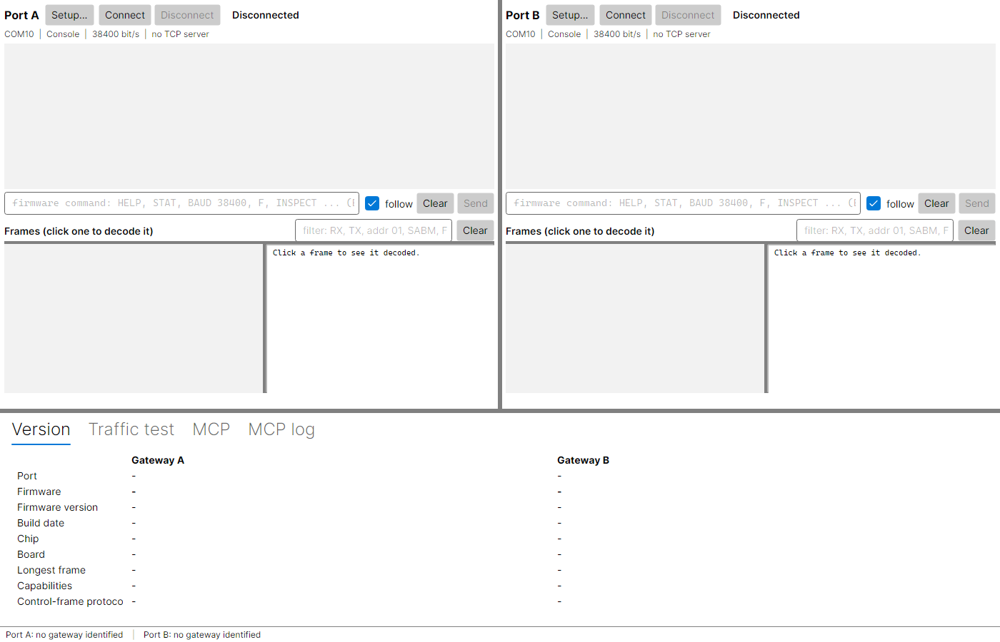
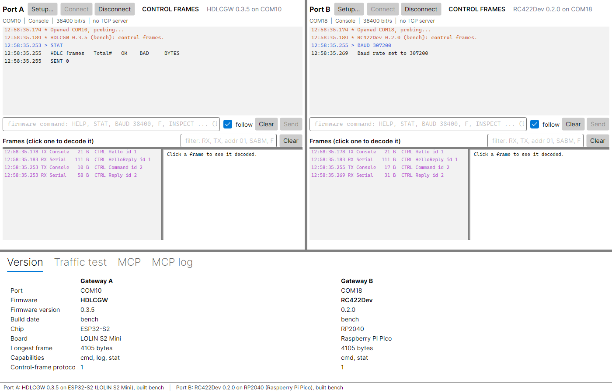
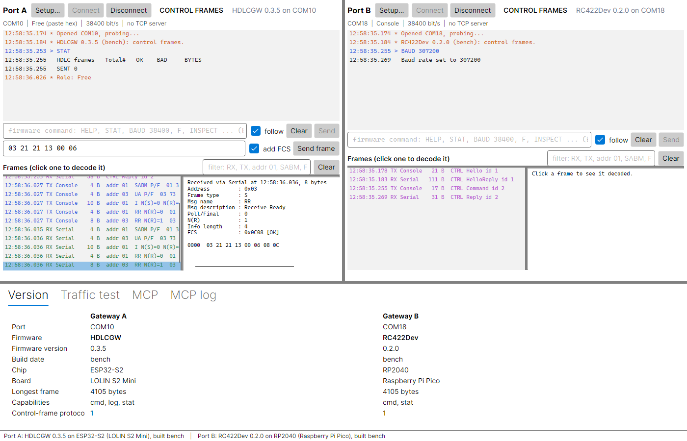
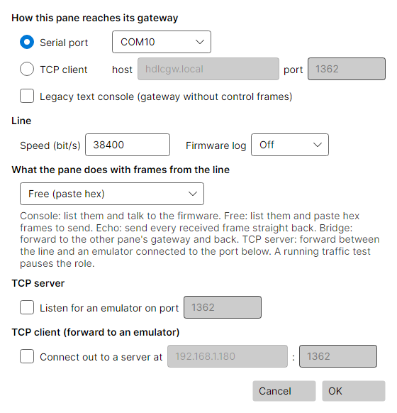
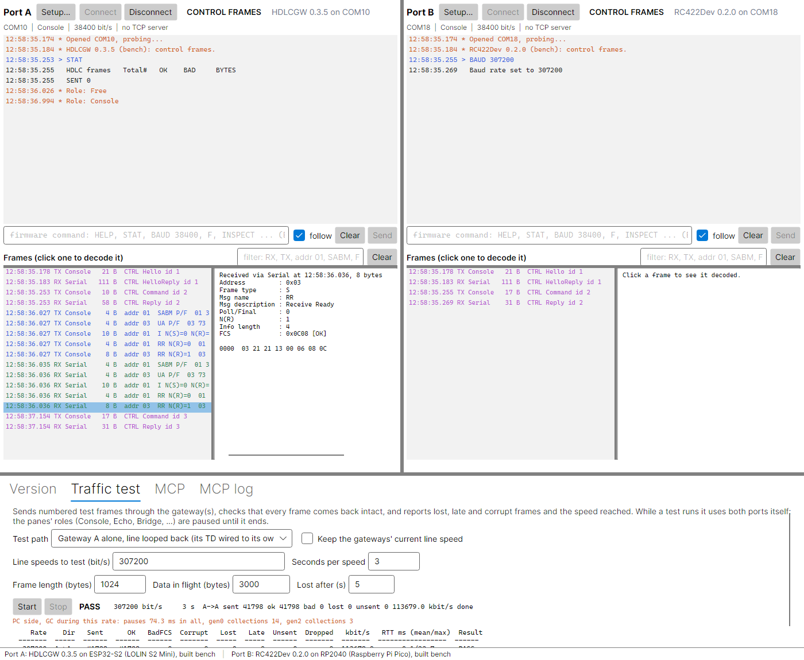
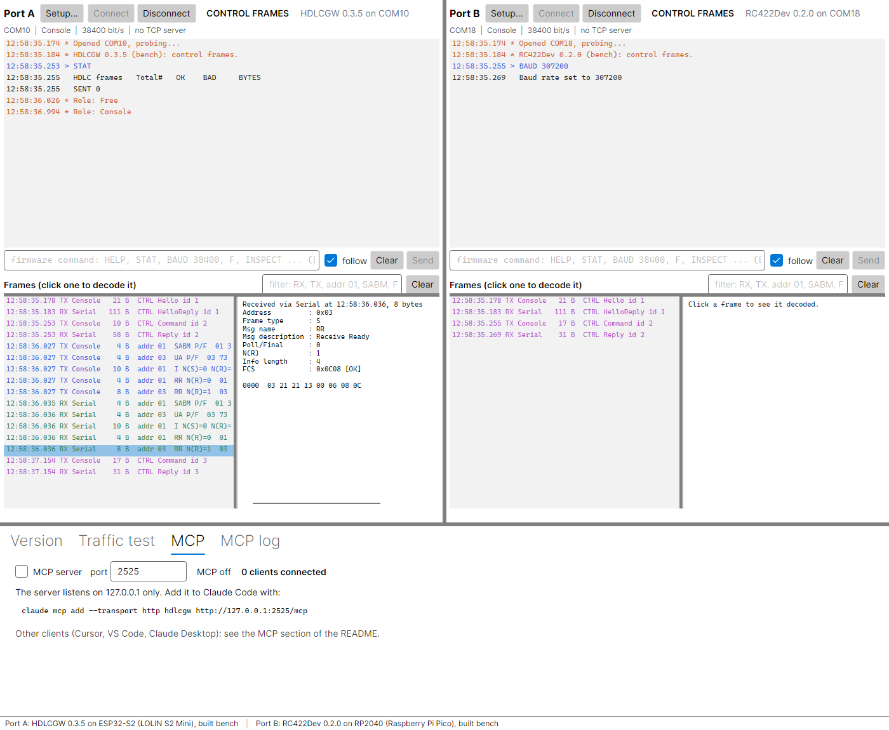

# hdlc-gateway-tool

The window: two panes, one HDLC gateway each, built on the same libraries as `hdlc-loopback`.

## What a pane does

- **Setup...** opens the pane's own window: serial port, or TCP client to `host:port` (a gateway in WiFi mode, `hdlcgw.local:1362`, or an emulator that listens), legacy console, line speed, role, TCP server port, firmware log level. OK applies it all; the line under the header shows the result. **Connect** to a COM port, or to `host:port`
  into the endpoint box. The tool sends HELLO; a firmware with control frames (HDLCGW 0.2.0
  and later) answers with its name and version and the badge says `CONTROL FRAMES`. If nothing
  answers within half a second the tool opens the legacy ESC ESC ESC text console, leaves it
  again, and tries HELLO once more (a board left in its text console by an earlier session
  types the first HELLO into its input line). Only when that is silent too is the firmware a
  text-console-only one (`TEXT CONSOLE (legacy)`: RC422Dev, older HDLCGW).
- **Console**: type a firmware command (`HELP`, `STAT`, `BAUD 38400`, `LOG 2`, `F`, `INSPECT`,
  ...), Enter sends, Up and Down walk the history. Replies, firmware log lines (`~`), events
  (`!`) and the tool's own notices (`*`) are colour coded. Commands an AI sent over MCP show as
  `> (mcp)`.
- **Line BAUD**: the gateway's transmit clock, sent as a `BAUD` command.
- **Firmware log**: the level of log frames the firmware sends while traffic flows (needs
  control frames). 2 shows bad frames and aborts, 4 one line per good frame.
- **Role**: what happens to a data frame the gateway receives.
  - *Console* (default) and *Free*: it is only listed. Free adds a hex box: paste bytes, tick
    "add FCS" or supply your own, Send frame.
  - *Echo*: it is sent straight back on the same port.
  - *Bridge*: it is sent on the other pane's port, and the other way round. Both panes must be
    connected; choosing Bridge on one pane sets both.
  - *TcpListen*: the pane also listens on a TCP port for the nd100x emulator, started with
    `--hdlc=N:<this-pc>:<port>`. Frames from the emulator go out on the line, frames from the
    line go to the emulator. Pane A and B need different ports (defaults 1362 and 1363).
- **Frames**: every frame in and out, newest last, with time, direction, source (Serial, Tcp,
  Echo, Bridge, Console, Mcp, Traffic), address, decoded control field and FCS verdict. Click
  one for the full decode and hex dump on the right. Control frames are purple, bad FCS red.
  The filter box keeps the rows whose text contains what you type: `RX`, `TX`, `addr 01`,
  `SABM`, `FCS BAD`, `Tcp`.

## Traffic test

While a traffic test runs, its data frames are counted by the engine but not listed in the
panes (listing 350000 frames a minute made the garbage collector pause the program for 8 s of
every 60); control frames are still listed. The Traffic test tab runs the same engine as `hdlc-loopback`: gateway A or B alone with its line looped back, or A to B
and B to A, at a list of rates, with the frame size, window, seconds per rate and timeout the
command-line tool takes. The status line and the PASS/FAIL table are the same text.

## MCP

Below the panes a tabbed area holds **Version** (what each gateway said in its HELLO reply:
firmware, version, build date, chip, board, longest frame, capabilities; the same in one line
each in the bottom bar), **Traffic test** (the test settings, status and report),
**MCP** (server on/off, port, status, how many clients are connected, and the `claude mcp add`
line to copy) and **MCP log** (every call, its result, and every client connecting or disconnecting).
Tick **MCP server** (remembered, default off) or start with `--mcp [port]` for one run. The
client count is the number of connections open to the MCP port: a client keeps its connection
between calls and closes it after about two minutes of silence.

## Screenshots

The pictures are the real window, drawn off screen by the screenshot test against fake gateways
that answer HELLO like the bench boards: HDLCGW 0.3.5 on an ESP32-S2 as COM10, RC422Dev 0.2.0 on
a Pico as COM18. The fakes loop every frame straight back and answer only a few commands, so the
command replies are short and the traffic test speed is not a line speed. Make them again after
a change to the window, from `src`:

```
dotnet test tests/HdlcGatewayTest.App.Tests -nodeReuse:false --filter "TestCategory=Screenshots"
```

### Just started

Nothing connected. Each pane has its Setup button, Connect, the console and the frame list.



Dark: [01-start-dark.png](../docs/screenshots/01-start-dark.png)

### Both gateways connected

Pane A on the ESP, pane B on the Pico. Both answered HELLO, so the badge says CONTROL FRAMES; a STAT on A and a BAUD on B went as command frames. The Version tab shows what each gateway reported.



Dark: [02-connected-version-dark.png](../docs/screenshots/02-connected-version-dark.png)

### Free role: sending frames by hand

Pane A in the Free role: frames typed in hex (SABM, UA, an I-frame, RR) go out with an FCS added and come back looped. Clicking a frame decodes it on the right.



Dark: [03-free-role-frames-dark.png](../docs/screenshots/03-free-role-frames-dark.png)

### Pane setup window

How the pane reaches its gateway (serial port or TCP client), the line speed, the firmware log level, the role, and the TCP server and TCP client for an emulator.



Dark: [04-pane-setup-dark.png](../docs/screenshots/04-pane-setup-dark.png)

### Traffic test, finished

Gateway A alone with its line looped back, 1024-byte frames at 307200 for 3 seconds: PASS. The result table under the PASS line scrolls inside the tab.



Dark: [05-traffic-test-dark.png](../docs/screenshots/05-traffic-test-dark.png)

### MCP tab

The MCP server switch and port, how many clients are connected, and the line that adds the server to Claude Code.



Dark: [06-mcp-tab-dark.png](../docs/screenshots/06-mcp-tab-dark.png)

## Settings

`%APPDATA%\HdlcGatewayTool\settings.json`: MCP on/off and port, the last endpoint and rate of
each pane, the TCP ports, the traffic test knobs. Delete it for defaults.
