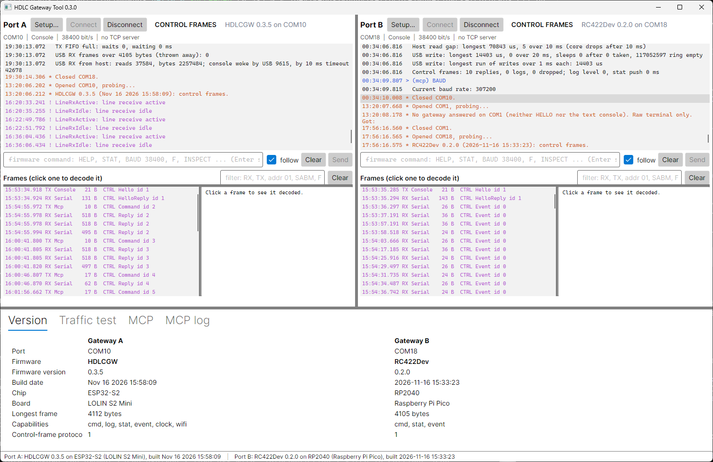

# HdlcGatewayTest

The PC side of the RetroCore Labs HDLC gateways (the ESP32-S2 **HDLCGW** and the Raspberry Pi
Pico **RC422Dev**): a two-pane window and a command-line tool that drive the gateways, list and
decode every frame, bridge two of them, forward frames to the nd100x emulator over TCP, run the
traffic test that proves a gateway moves frames without loss, and let an AI client do all of
that over MCP. Source, releases and issues:
[github.com/RetroCoreLabs/HdlcGatewayTest](https://github.com/RetroCoreLabs/HdlcGatewayTest).

| Page | What it covers |
|---|---|
| [Overview](../../README.md) | Why the tool exists, what it is used for, quick start, MCP set-up, building |
| [Window](../HdlcGatewayTest.App/README.md) | `hdlc-gateway-tool`: panes, roles, traffic test, MCP, screenshots |
| [Command line](../HdlcGatewayTest.Loopback/README.md) | `hdlc-loopback`: the traffic test and console commands from a script |
| [API reference](api/index.md) | Every namespace, type and member, from the code comments |

The firmware these tools drive has its own site:
[retrocorelabs.github.io/HDLCGW](https://retrocorelabs.github.io/HDLCGW/), with the
[bench setups](https://retrocorelabs.github.io/HDLCGW/docs/Bench-Setups/) the tools were used in.
